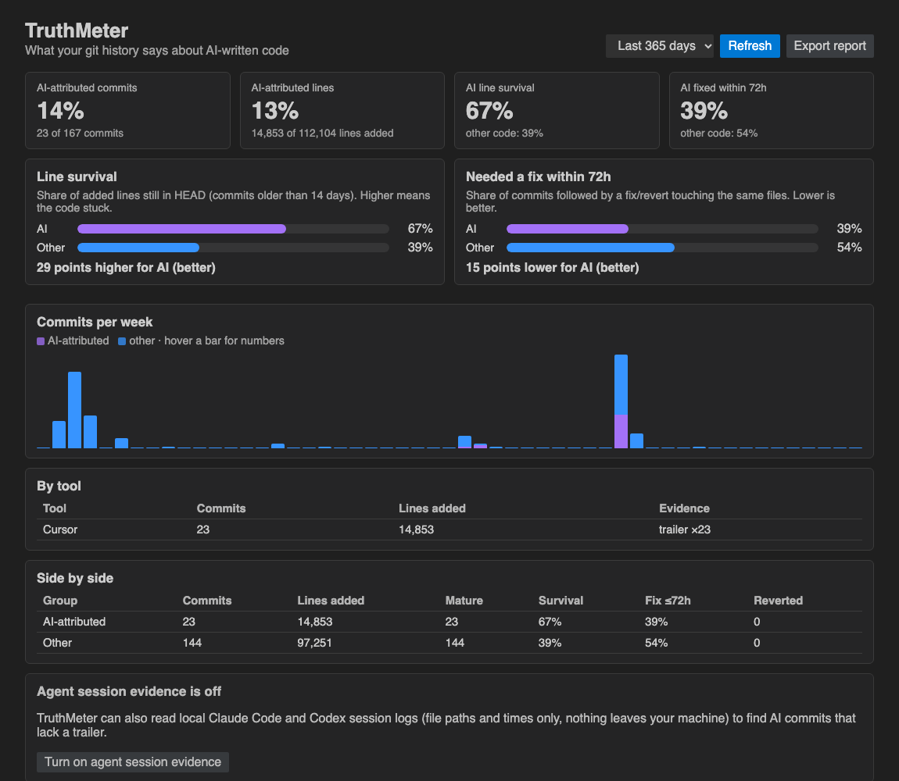

# TruthMeter AI

**How much of your code is AI-written, and does it stick?** TruthMeter answers from evidence your
repository already has (git attribution, `git blame` and, if you allow it, local agent session
logs) instead of guessing from typing speed.



## What it measures

| Metric | How it's computed |
|---|---|
| **AI-attributed commits and lines** | Commits that *record* AI involvement: a `Co-authored-by` trailer, an agent bot as author, or a tool footer like “Generated with Claude Code”. |
| **Line survival** | Of the lines a commit added, the share `git blame -w` still attributes to it at HEAD. Only commits older than 14 days count. AI-attributed vs. everything else. |
| **Fix within 72h** | Share of commits followed within 72 hours by a fix/revert-style commit touching the same files (manifests and READMEs ignored). |
| **By tool** | Claude Code, GitHub Copilot, Cursor, OpenAI Codex, Gemini/Jules, Aider, Devin, Windsurf, Amazon Q/Kiro, plus your own rules. |
| **Agent session evidence** *(opt-in)* | Files that Claude Code or Codex edited, read from their local session logs, matched to commits that have **no** AI trailer. This shows how much AI work your trailers miss. |

Rates stay hidden until each group has at least 5 commits old enough to judge. A rate based on
two commits is noise.

## Why 2.0 is a rewrite

Version 1.x flagged edits as AI-generated using regular expressions and keystroke timing. In
practice those patterns matched almost all code: one `import` line, `items.map(`, a typed
parameter, or any three lines of text all came back as "AI". The percentages and dollar figures
built on top of that weren't measuring anything.

No editor API reports when another extension's suggestion is accepted, so in-editor detection
can't be made reliable. The evidence that does exist is in git history and agent session logs,
and that's all 2.0 uses.

## Getting started

1. Install from the [VS Code Marketplace](https://marketplace.visualstudio.com/items?itemName=JeffreyJose.truthmeter-ai)
   or [Open VSX](https://open-vsx.org/extension/jeffreyjose07/truthmeter-ai) (Cursor, Windsurf, VSCodium, Antigravity).
2. Open a folder that is a git repository. The status bar shows the AI-attributed commit share.
3. Click it, or run **TruthMeter: Show Dashboard**.
4. Optional: **TruthMeter: Turn On Agent Session Evidence**.

### Getting good data

TruthMeter can only count what your history records. To make AI work visible:

- **Claude Code** adds `Co-Authored-By: Claude …` by default. Keep it on.
- **Cursor** adds `Co-authored-by: Cursor Agent` for agent commits.
- **Codex CLI** has a `commit_attribution` setting in `config.toml`.
- **VS Code + Copilot**: `git.addAICoAuthor`. Because it can stamp commits where Copilot wrote
  little, Copilot trailers are shown as *medium confidence*. Turn off
  `truthmeter.attribution.trustCopilotTrailer` to exclude them.
- Squash merges keep trailers only if your merge tool copies them into the squash message.

## Settings

| Setting | Default | |
|---|---|---|
| `truthmeter.windowDays` | `90` | Days of history to analyse. |
| `truthmeter.survival.minAgeDays` | `14` | Minimum commit age for survival and fix-rate stats. |
| `truthmeter.survival.maxFiles` | `400` | Cap on files blamed. Least-touched files are skipped first. |
| `truthmeter.agentLogs.enabled` | `false` | Read local Claude Code / Codex session logs. |
| `truthmeter.attribution.trustCopilotTrailer` | `true` | Count Copilot co-author trailers. |
| `truthmeter.attribution.customRules` | `[]` | `[{ "tool": "Our Bot", "pattern": "\\[ai\\]" }]`, a regex tested against author, committer and message. |
| `truthmeter.excludePatterns` | lock files, build output | Path regexes left out of line counts. |
| `truthmeter.statusBar.enabled` | `true` | Show the status bar item. |

## Privacy

Everything runs locally: `git log`, `git blame`, and (only if you opt in) reading session logs
under `~/.claude/projects` and `~/.codex/sessions`. From those logs TruthMeter extracts only file
paths inside the open workspace and their timestamps. No telemetry, no network calls. The
extension only runs in trusted workspaces, because it executes git there.

## Limits worth knowing

- These are correlations in your own history, not causal proof. AI commits are often different
  work (tests, scaffolding, refactors) from the rest.
- Survival treats files renamed after a commit as "not surviving", for both groups equally.
- Commits made without any trailer and without a local agent log are invisible to TruthMeter.
  That's the point: it reports only what it can show.

## Development

```bash
npm ci
npm run test:unit      # unit + integration tests against back-dated fixture git repos
npm run test:e2e       # launches VS Code 1.90 with the extension; VSCODE_VERSION=stable for latest
npm run analyze -- /path/to/repo --days 180 --agent-logs   # same analysis from the command line
```

Publishing: push a `vX.Y.Z` tag matching `package.json`. GitHub Actions tests, then publishes to
the VS Code Marketplace (OIDC trusted publishing, with a PAT fallback until 2026-12-01), Open VSX,
and a GitHub release.

## License

AGPL-3.0
